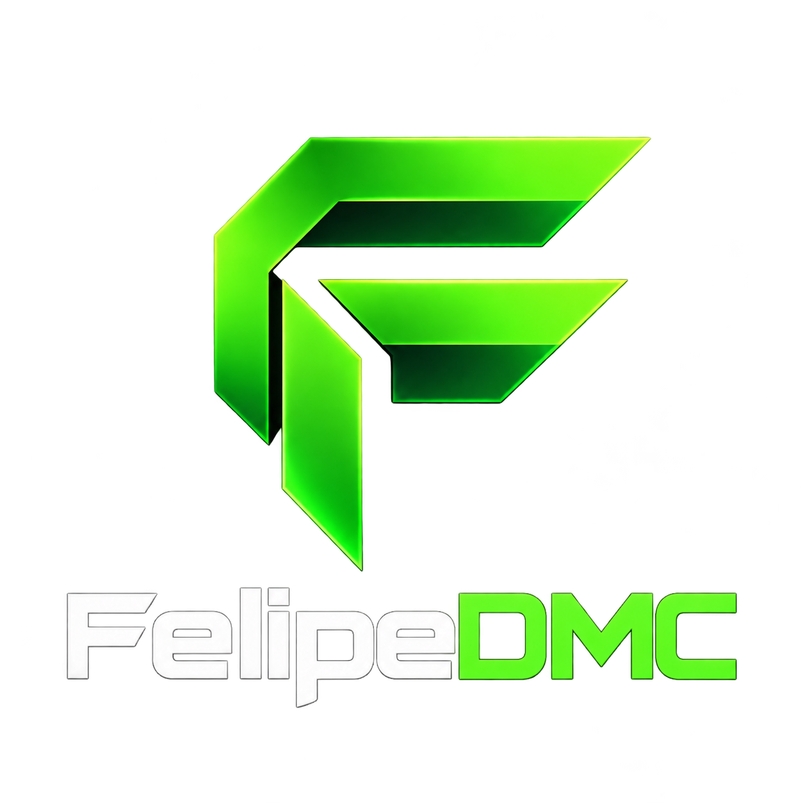

# ClipForge · by FelipeDMC



Editor de clips y videos completos que procesa las grabaciones en el navegador. Interfaz negra con verde brillante, logo propio y exportaciones en segundo plano.

**Versión 1.8.0 · paquete completo para GitHub.**

## Abrir en tu computadora

Necesitas [Node.js](https://nodejs.org/) 22 o superior; este paquete se verificó con Node.js 24. No hace falta ejecutar `npm install` para abrir la aplicación.

**Windows:** extrae el ZIP, entra en la carpeta `ClipForge` y abre `INICIAR_CLIPFORGE.bat`. Después abre la dirección que muestra la ventana, normalmente <http://localhost:8000/>.

**Windows, macOS o Linux, desde una terminal dentro de la carpeta:**

```sh
npm start
```

También puedes usar `node scripts/serve.mjs`. Mantén esa terminal abierta; `Ctrl+C` detiene el servidor. Si el puerto 8000 está ocupado, cierra la otra instancia o cambia la variable `PORT` antes de iniciar.

Abre el sitio mediante esa dirección; abrir `dist/index.html` directamente con doble clic no sirve para cargar correctamente los módulos y workers. Para trabajar con video, utiliza un navegador de escritorio con WebCodecs. Los códecs y la aceleración disponibles dependen del navegador y del equipo.

## Subir a GitHub y publicar la página

Sigue **[SUBIR_A_GITHUB.md](SUBIR_A_GITHUB.md)**. Incluye comandos para crear el repositorio y un flujo preparado para publicar `dist/` en GitHub Pages.

**`dist/` contiene el código fuente real de la aplicación y todos sus recursos. Debe subirse completo.** No hay una carpeta `src/` ni un paso de compilación pendiente. La web funciona como sitio estático: no necesita servidor de aplicaciones, base de datos, cuenta de OpenAI ni claves de API.

## Qué incluye

- Importación de grabaciones y detección de momentos por sonido e imagen.
- Detección local de avisos de eliminación de Fortnite mediante OCR, con agrupación de bajas y ajustes de contexto.
- Edición de clips desde la línea de tiempo, recorte, deshacer/rehacer y formatos 9:16, 16:9 y 1:1.
- Brillo, contraste, saturación, nitidez, encuadre, texto, volumen y marca de agua opcional. Perfil «Fortnite nítido» ajustable.
- Edición y exportación del **video completo** con la configuración elegida, sin tener que crear un clip.
- Exportación MP4 H.264/AAC o WebM VP9/Opus, según la compatibilidad del navegador. Opciones de resolución hasta 2160p y tasas hasta 240 fps, sujetas al codificador disponible.
- Cola de exportaciones con panel minimizable para seguir buscando y editando clips. Cada trabajo conserva su original y sus ajustes.
- Escritura por partes en almacenamiento temporal y guardado directo en disco cuando el navegador lo admite.
- Muestra real de cuatro segundos antes de exportar, proyectos JSON y ajustes guardados localmente.
- Logo FelipeDMC, iconos de instalación, favicon, demo sintética y bibliotecas de video/OCR incluidas.

## Carpetas y archivos

| Ubicación | Contenido |
| --- | --- |
| `dist/index.html` | Página y controles del editor. |
| `dist/app.js` | Interfaz, estado, vista previa y proyectos. |
| `dist/core.js`, `dist/image-quality.js` | Composición y ajustes de imagen compartidos por vista previa y exportación. |
| `dist/media-worker.js` | Análisis y conversión fuera del hilo de la interfaz. |
| `dist/export-*.js`, `dist/export-queue.css` | Cola, panel, descargas y almacenamiento de exportaciones. |
| `dist/timeline-editor.js`, `dist/frame-*.js` | Línea de tiempo, tasas de fotogramas y mezcla temporal. |
| `dist/fortnite-*.js` | Lectura del HUD e interpretación de eliminaciones. |
| `dist/styles.css`, `dist/studio.css`, `dist/neon.css` | Diseño del editor y paleta verde/negra. |
| `dist/assets/`, `dist/icons/`, `dist/favicon.*` | Logo e iconos. |
| `dist/manifest.webmanifest` | Nombre, iconos y rutas de instalación. |
| `dist/vendor/` | Mediabunny, Tesseract, modelos locales y licencias. |
| `dist/demo.mp4` | Video sintético incluido para probar la aplicación. |
| `scripts/` | Servidor local y herramientas opcionales para regenerar recursos. |
| `tests/` | Pruebas del proyecto. |
| `.github/workflows/pages.yml` | Publicación automática de `dist/` en GitHub Pages. |
| `docs/` | Dependencias, procedencia e historial técnico. |

## Comprobaciones

Sin instalar dependencias:

```sh
npm run check
npm run test:media
```

La primera orden comprueba sintaxis y ejecuta 65 pruebas. La segunda inspecciona el MP4 de demostración con el motor de video real. Para las pruebas opcionales de interfaz y OCR, consulta [docs/DEPENDENCIAS.md](docs/DEPENDENCIAS.md).

Los resultados de esta entrega están en [VERIFICACION.txt](VERIFICACION.txt). Las pruebas de interfaz simulan los códecs: no certifican compatibilidad 4K/240 fps en cualquier dispositivo.

## Uso y límites

La aplicación procesa el original en el navegador. No sube las grabaciones a un servicio de edición u OCR. El ZIP incluye una demo sintética, no las grabaciones personales ni los proyectos guardados en tu navegador.

No hay un límite artificial de 60 segundos para exportar; siguen contando el espacio libre, la memoria, los códecs y los recursos del equipo. «Máximo compatible» busca una tasa admitida por el navegador; una selección fija incompatible genera un error en vez de reducirla silenciosamente. Aumentar resolución o fps no recupera detalle que no existe en el archivo original. El suavizado mezcla fotogramas y puede producir estelas.

**Deja la página abierta hasta que terminen las exportaciones.** La cola permite trabajar mientras convierte, pero no se reanuda después de cerrar, recargar o suspender el equipo. Descarga los resultados antes de limpiar la cola o cerrar la sesión.

El OCR puede omitir o confundir avisos; revisa las propuestas. La detección por actividad no certifica eliminaciones. La instalación usa el icono de ClipForge, pero esta versión no incluye funcionamiento offline mediante service worker.

Al cambiar del sitio actual a GitHub Pages cambia el origen del navegador: descarga tus proyectos JSON desde el editor anterior y ábrelos en el nuevo junto con sus grabaciones originales. Los datos locales no se trasladan automáticamente.

## Dependencias y procedencia

Las bibliotecas incluidas conservan sus licencias; consulta [docs/DEPENDENCIAS.md](docs/DEPENDENCIAS.md). No se añadió una licencia nueva para el código propio del proyecto.

Este paquete procede de la publicación 11. [docs/PAQUETE_GITHUB.md](docs/PAQUETE_GITHUB.md) explica las adaptaciones para GitHub. El README anterior se conserva sin cambios en [docs/HISTORIAL_TECNICO.md](docs/HISTORIAL_TECNICO.md); sus notas de alojamiento describen el sitio original.
